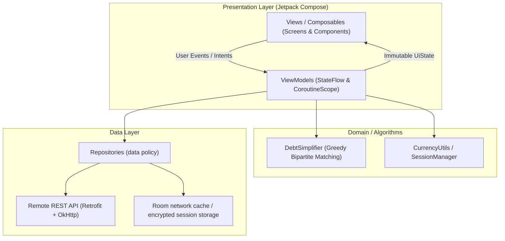

# App Architecture

> Graded under **A3 — Architecture & Data Design**. Explains **what** we built, **how** data flows, and **why** specific design trade-offs were made.

---

## 1. Layers & Responsibilities

The MoneyCare mobile application strictly follows the **Android Modern Architecture (MVVM + Repository Pattern)** recommended by Google. Screens are kept thin: they solely render state and dispatch user events.



| Layer | Our implementation (folders / main classes) | Owner (member) |
|-------|---------------------------------------------|----------------|
| **Presentation** | `app/.../ui/*`<br>• `ui/home/*`: `HomeScreen.kt`, `HomeViewModel.kt`<br>• `ui/personal/*`: `TransactionFormScreen.kt`, `WalletManagementScreen.kt`, `PersonalTransactionViewModel.kt`<br>• `ui/group/*`: `GroupDetailScreen.kt`, `GroupSettlementContent.kt`, `viewmodel/GroupDetailViewModel.kt`<br>• `ui/theme/*`, `ui/components/*`, `ui/navigation/AppNavigation.kt` | **Đặng Xuân Anh** |
| **Domain & Algorithms** | `app/.../util/*`<br>• `DebtSimplifier.kt` *(Thuật toán tham lam rút gọn nợ tối giản số lần chuyển khoản)*<br>• `CurrencyUtils.kt` *(Định dạng tiền tệ VNĐ và số nguyên Long)* | **Nguyễn Văn Hiếu** |
| **Data & Persistence** | `app/.../data/*`<br>• `data/repository/PersonalFinanceRepository.kt` *(Thu chi cá nhân, ví, ngân sách)*<br>• `data/repository/HybridExpenseRepository.kt`, `RealGroupRepository.kt`<br>• `data/model/*` *(Transaction, Wallet, Goal, Group, Expense, Split)*<br>• `backend/` *(Spring Boot REST API & MySQL)* | **Nguyễn Văn Hiếu** |
| **Network & Security** | `app/.../data/api/*` & `app/.../util/*`<br>• `data/api/ApiService.kt`, `RetrofitClient.kt` *(Cấu hình Interceptor, Token Header)*<br>• `util/SessionManager.kt` *(Quản lý token bảo mật qua Android Keystore)* | **Nguyễn Minh Hùng** |

---

## 2. State Management

**Our choice:** Android Jetpack `ViewModel` + Kotlin Coroutines `StateFlow`.

**Why:**
- `StateFlow` phát ra luồng dữ liệu bất biến (immutable state stream), an toàn với vòng đời của Jetpack Compose (`collectAsStateWithLifecycle()`).
- Tự động giữ nguyên trạng thái khi xoay màn hình (Configuration changes).
- Loại bỏ hoàn toàn callback phức tạp hoặc biến toàn cục dễ gây memory leak.

### Chuẩn hóa 4 trạng thái giao diện (4 UI States):
Các màn hình dữ liệu chính suy ra trạng thái nội dung từ một sealed interface dùng chung:

```kotlin
sealed interface LoadState<out T> {
    data object Loading : LoadState<Nothing>
    data class Success<T>(val data: T) : LoadState<T>
    data object Empty : LoadState<Nothing>
    data class Error(val message: String) : LoadState<Nothing>
}
```

Ở màn hình Jetpack Compose, giao diện được render tường minh:
```kotlin
when (val state = uiState.contentState) {
    LoadState.Loading -> LoadingSkeleton()
    is LoadState.Success -> TransactionList(state.data)
    LoadState.Empty -> EmptyStateView("Chưa có giao dịch nào")
    is LoadState.Error -> ErrorRetryContent(state.message, onRetry = viewModel::refresh)
}
```

---

## 3. Data Flow: Quyết toán nợ nhóm & Đồng bộ ví cá nhân

Luồng dữ liệu mẫu từ khi người dùng mở Tab Quyết toán nhóm cho đến khi đồng bộ số tiền đã chi vào sổ thu chi cá nhân:

```mermaid
sequenceDiagram
    autonumber
    actor User
    participant View as GroupDetailScreen / GroupSettlementContent
    participant VM as GroupDetailViewModel
    participant Algo as DebtSimplifier
    participant GRepo as RealGroupRepository
    participant API as Spring Boot API
    participant PRepo as PersonalFinanceRepository
    participant DB as MySQL / Room cache

    User->>View: Chuyển sang Tab "Quyết toán" (Settlement)
    View->>VM: loadGroupDetail(groupId)
    VM->>VM: Tính netBalance từng thành viên (Paid - Owed)
    VM->>Algo: simplifyDebts(netBalances)
    Algo-->>VM: Kế hoạch DebtSettlement (X trả Y amount)
    VM-->>View: Render danh sách thanh toán & Tổng net cá nhân

    User->>View: Xác nhận một khoản đã trả
    View->>VM: settleDebt(from, to, amount)
    VM->>GRepo: POST /groups/{id}/settlements
    GRepo->>API: Lưu settlement độc lập
    API-->>VM: Settlement đã lưu
    
    User->>View: Nhấn nút "Đồng bộ vào ví cá nhân"
    View->>VM: syncTripToPersonalWallet(walletId, categoryId)
    VM->>PRepo: POST /groups/{id}/sync-personal
    PRepo->>API: Gửi groupId, walletId, categoryId
    API->>DB: Tự tính phần chi phí; INSERT lần đầu hoặc UPDATE giao dịch cũ
    API->>DB: Khóa thành viên + giao dịch; hoàn tác số cũ rồi áp dụng phần mới
    PRepo->>DB: Cache giao dịch trả về bằng Room
    DB-->>PRepo: Success
    PRepo-->>VM: Result.Success
    VM-->>View: Hiển thị Snackbar "Đồng bộ thành công!"
```

---

## 4. Offline Strategy & Security

| Loại dữ liệu | Nơi lưu trữ | Chính sách đọc (Read Policy) | Chính sách ghi (Write Policy) | Xử lý xung đột (Conflict Handling) |
|--------------|-------------|------------------------------|-------------------------------|-----------------------------------|
| **Dashboard, giao dịch & ví cá nhân** | Spring API + Room cache | Network-first; nếu request lỗi thì trả snapshot gần nhất của đúng `userId`. `cache_markers` phân biệt collection rỗng hợp lệ với chưa từng cache | Thao tác ghi cần mạng; response thành công được cập nhật vào Room | Server là nguồn chân lý; Room v2 có thể tái tạo vì chỉ là cache |
| **Mục tiêu tiết kiệm** | Spring API / MySQL | Đọc qua API | Ghi qua API | Chưa hỗ trợ offline; lỗi có Retry |
| **Dữ liệu chuyến đi / Nhóm** | Spring API / MySQL | Đọc qua API | Gửi qua Retrofit; timeout hiển thị Error + Retry | Server-wins cho dữ liệu nhóm đa người dùng |
| **Token xác thực (JWT)** | Ciphertext trong `SharedPreferences` | `SessionManager` giải mã khi gắn Authorization header | AES/GCM trước khi ghi | Khóa AES được tạo và giữ trong **Android Keystore** |

---

## 5. Project Structure

```text
mobile-project-3/
├── app/app/src/main/java/com/moneycare/app/
│   ├── data/
│   │   ├── api/             # RetrofitClient, ApiService, OkHttp Interceptors
│   │   ├── local/           # Room DB, DAO, cache entities và local data source
│   │   ├── model/           # Data Transfer Objects (DTO) & Domain Models
│   │   └── repository/      # Auth, PersonalFinance, HybridExpense, RealGroup repositories
│   ├── di/                  # AppContainer (manual dependency injection)
│   ├── ui/
│   │   ├── auth/            # Login, Register, Forgot Password screens & ViewModels
│   │   ├── components/      # CommonHeader, ValidationMessage, GroupDialogs
│   │   ├── group/           # GroupDetailScreen, GroupSettlementContent, GroupReportScreen
│   │   ├── home/            # HomeScreen, PersonalHomeContent, GroupHomeContent
│   │   ├── navigation/      # AppNavigation.kt (Compose Navigation Graph)
│   │   ├── personal/        # TransactionFormScreen, WalletManagementScreen, SavingsGoalsScreen
│   │   └── theme/           # Color.kt, PastelPalette, Theme.kt, Type.kt
│   ├── util/                # DebtSimplifier.kt, CurrencyUtils.kt, SessionManager.kt
│   └── viewmodel/           # GroupDetailViewModel.kt, GroupReportViewModel.kt
├── backend/                 # Spring Boot REST API Service, MySQL Schema Dump & db.json
└── docs/                    # Tài liệu đặc tả M1-M3: proposal, ui-design, architecture, ai-log
```

---

## 6. Design Decisions & Trade-offs

| Quyết định thiết kế | Phương án thay thế đã cân nhắc | Lý do chọn lựa (Trade-off & Rationale) |
|---------------------|-------------------------------|----------------------------------------|
| **Thuật toán tham lam Greedy cho kế hoạch quyết toán** | Duy trì ma trận nợ từng cặp hoặc giải bài toán tối ưu tổ hợp | Greedy gom thành Net Balance, bảo toàn tổng tiền và sinh không quá $N - 1$ giao dịch. Cách này dễ hiểu và nhanh, nhưng nhóm không tuyên bố bảo đảm số giao dịch tối thiểu toàn cục cho mọi bộ dữ liệu. Settlement đã trả được lưu riêng, không sửa lịch sử hóa đơn. |
| **Sử dụng số nguyên `Long` (VNĐ) thay vì `Double`** | Sử dụng kiểu số thực `Double` / `Float` thông thường | Số thực nhị phân (IEEE 754) gây ra sai số làm tròn khi chia bill (e.g., $100.000 / 3 = 33333.3333...$). Chuyển sang số nguyên `Long` VNĐ và phân bổ phần dư cho người thanh toán đảm bảo tổng số tiền trước và sau quyết toán luôn khớp từng đồng. |
| **Tạo ví nhanh "+ Ví khác..." ngay trong form giao dịch** | Bắt người dùng phải thoát form, mở màn hình Quản lý ví để tạo ví trước rồi mới quay lại | Giảm tối đa ma sát người dùng (User Friction). Người dùng có thể vừa nhập hóa đơn từ ví MoMo/ZaloPay mới vừa tạo ví tức thời mà không bị gián đoạn hay mất dữ liệu đang gõ dở trên form. |
| **Lưu Token bằng AES/GCM + Android Keystore** | Lưu JWT plaintext trong `SharedPreferences` | File preferences chỉ chứa ciphertext và IV; khóa AES không được ghi vào repository hoặc file preferences. Đây không phải API `EncryptedSharedPreferences`, mà là mã hóa trực tiếp trong `SessionManager`. |
| **Room theo chiến lược network-first cache** | Local-first với outbox đồng bộ hai chiều | Đủ để xem dashboard, giao dịch và ví khi mất mạng mà không phải giải quyết ID tạm/xung đột ghi. Đổi lại, tạo/sửa/xóa vẫn cần mạng và server là nguồn chân lý. |
| **Manual dependency injection (`AppContainer`)** | Hilt/Dagger hoặc khởi tạo repository trong từng ViewModel | Giữ dependency graph nhỏ, dễ mock trong unit test và dễ giải thích khi bảo vệ; không để Composable gọi API/database trực tiếp. |
