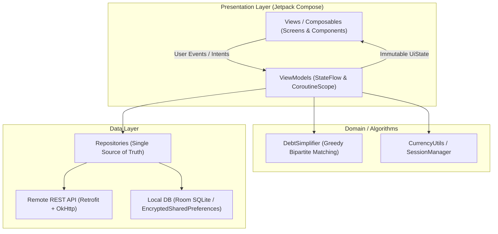
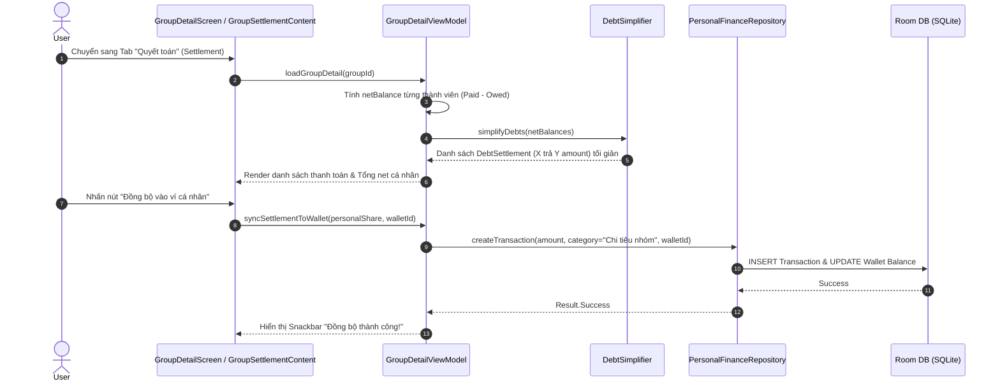

# App Architecture

> Graded under **A3 — Architecture & Data Design**. Explains **what** we built, **how** data flows, and **why** specific design trade-offs were made.

---

## 1. Layers & Responsibilities

The MoneyCare mobile application strictly follows the **Android Modern Architecture (MVVM + Repository Pattern)** recommended by Google. Screens are kept thin: they solely render state and dispatch user events.



| Layer | Our implementation (folders / main classes) | Owner (member) |
|-------|---------------------------------------------|----------------|
| **Presentation** | `app/.../ui/*`<br>• `ui/home/*`: `HomeScreen.kt`, `HomeViewModel.kt`<br>• `ui/personal/*`: `TransactionFormScreen.kt`, `WalletManagementScreen.kt`, `PersonalTransactionViewModel.kt`<br>• `ui/group/*`: `GroupDetailScreen.kt`, `GroupSettlementContent.kt`, `viewmodel/GroupDetailViewModel.kt`<br>• `ui/theme/*`, `ui/components/*`, `ui/navigation/AppNavigation.kt` | **Đặng Xuân Anh** |
| **Domain & Algorithms** | `app/.../util/*`<br>• `DebtSimplifier.kt` *(Thuật toán tham lam rút gọn nợ tối giản số lần chuyển khoản)*<br>• `CurrencyUtils.kt` *(Định dạng tiền tệ VNĐ và số nguyên Long)* | **Nguyễn Văn Hiếu** |
| **Data & Persistence** | `app/.../data/*`<br>• `data/repository/PersonalFinanceRepository.kt` *(Thu chi cá nhân, ví, ngân sách)*<br>• `data/repository/HybridExpenseRepository.kt`, `RealGroupRepository.kt`<br>• `data/model/*` *(Transaction, Wallet, Goal, Group, Expense, Split)*<br>• `backend/` *(Spring Boot REST API & MySQL)* | **Nguyễn Văn Hiếu** |
| **Network & Security** | `app/.../data/api/*` & `app/.../util/*`<br>• `data/api/ApiService.kt`, `RetrofitClient.kt` *(Cấu hình Interceptor, Token Header)*<br>• `util/SessionManager.kt` *(Quản lý token bảo mật qua Android Keystore)* | **Nguyễn Minh Hùng** |

---

## 2. State Management

**Our choice:** Android Jetpack `ViewModel` + Kotlin Coroutines `StateFlow`.

**Why:**
- `StateFlow` phát ra luồng dữ liệu bất biến (immutable state stream), an toàn với vòng đời của Jetpack Compose (`collectAsStateWithLifecycle()`).
- Tự động giữ nguyên trạng thái khi xoay màn hình (Configuration changes).
- Loại bỏ hoàn toàn callback phức tạp hoặc biến toàn cục dễ gây memory leak.

### Chuẩn hóa 4 trạng thái giao diện (4 UI States):
Mọi màn hình tải dữ liệu bất đồng bộ trong ứng dụng đều được mô hình hóa qua một sealed class/interface đại diện cho 4 trạng thái:

```kotlin
sealed interface UiState<out T> {
    object Loading : UiState<Nothing>
    data class Success<T>(val data: T) : UiState<T>
    object Empty : UiState<Nothing>
    data class Error(val message: String, val canRetry: Boolean = true) : UiState<Nothing>
}
```

Ở màn hình Jetpack Compose, giao diện được render tường minh:
```kotlin
when (val state = uiState) {
    is UiState.Loading -> LoadingSkeleton()
    is UiState.Success -> TransactionList(state.data)
    is UiState.Empty -> EmptyStateView("Chưa có giao dịch nào")
    is UiState.Error -> ErrorRetryView(state.message, onRetry = { viewModel.retry() })
}
```

---

## 3. Data Flow: Quyết toán nợ nhóm & Đồng bộ ví cá nhân

Luồng dữ liệu mẫu từ khi người dùng mở Tab Quyết toán nhóm cho đến khi đồng bộ số tiền đã chi vào sổ thu chi cá nhân:



---

## 4. Offline Strategy & Security

| Loại dữ liệu | Nơi lưu trữ | Chính sách đọc (Read Policy) | Chính sách ghi (Write Policy) | Xử lý xung đột (Conflict Handling) |
|--------------|-------------|------------------------------|-------------------------------|-----------------------------------|
| **Sổ thu chi & Ví cá nhân** | Local Room DB (SQLite) | Luôn đọc trực tiếp từ Local DB (Zero latency, 100% offline) | Ghi ngay vào Local DB, cập nhật StateFlow tức thì | Không có xung đột (dữ liệu thuộc quyền sở hữu riêng của 1 thiết bị) |
| **Mục tiêu tiết kiệm** | Local Room DB (SQLite) | Đọc từ Local DB | Ghi vào Local DB | Local là nguồn chân lý duy nhất |
| **Dữ liệu chuyến đi / Nhóm** | Remote REST API + Bộ nhớ đệm (Cache) | Ưu tiên tải từ API; nếu mất mạng thì hiển thị bản lưu đệm gần nhất kèm thông báo Offline | Gửi lên REST API qua OkHttp; nếu timeout thì báo lỗi kèm nút Retry | Server-wins cho các giao dịch nhóm đa người dùng |
| **Token xác thực (JWT)** | `EncryptedSharedPreferences` | Đọc qua `SessionManager` khi gắn Header Authorization | Ghi khi đăng nhập thành công | Key lưu trữ trong phần cứng an toàn qua **Android Keystore** |

---

## 5. Project Structure

```text
mobile-project-3/
├── app/app/src/main/java/com/moneycare/app/
│   ├── data/
│   │   ├── api/             # RetrofitClient, ApiService, OkHttp Interceptors
│   │   ├── model/           # Data Transfer Objects (DTO) & Domain Models
│   │   └── repository/      # PersonalFinanceRepository, HybridExpenseRepository, RealGroupRepository
│   ├── ui/
│   │   ├── auth/            # Login, Register, Forgot Password screens & ViewModels
│   │   ├── components/      # CommonHeader, ValidationMessage, GroupDialogs
│   │   ├── group/           # GroupDetailScreen, GroupSettlementContent, GroupReportScreen
│   │   ├── home/            # HomeScreen, PersonalHomeContent, GroupHomeContent
│   │   ├── navigation/      # AppNavigation.kt (Compose Navigation Graph)
│   │   ├── personal/        # TransactionFormScreen, WalletManagementScreen, SavingsGoalsScreen
│   │   └── theme/           # Color.kt, PastelPalette, Theme.kt, Type.kt
│   ├── util/                # DebtSimplifier.kt, CurrencyUtils.kt, SessionManager.kt
│   └── viewmodel/           # GroupDetailViewModel.kt, GroupReportViewModel.kt
├── backend/                 # Spring Boot REST API Service, MySQL Schema Dump & db.json
└── docs/                    # Tài liệu đặc tả M1-M3: proposal, ui-design, architecture, ai-log
```

---

## 6. Design Decisions & Trade-offs

| Quyết định thiết kế | Phương án thay thế đã cân nhắc | Lý do chọn lựa (Trade-off & Rationale) |
|---------------------|-------------------------------|----------------------------------------|
| **Thuật toán tham lam Greedy cho quyết toán nợ** | Duy trì ma trận nợ từng cặp (Direct Pairwise Debts) | Nếu dùng ma trận từng cặp, trong nhóm 5 người có thể phát sinh tới $5 \times 4 / 2 = 10$ giao dịch rắc rối. Thuật toán Greedy gom thành Net Balance và chỉ sinh tối đa $N - 1$ giao dịch chuyển tiền (tối đa 4 lượt). |
| **Sử dụng số nguyên `Long` (VNĐ) thay vì `Double`** | Sử dụng kiểu số thực `Double` / `Float` thông thường | Số thực nhị phân (IEEE 754) gây ra sai số làm tròn khi chia bill (e.g., $100.000 / 3 = 33333.3333...$). Chuyển sang số nguyên `Long` VNĐ và phân bổ phần dư cho người thanh toán đảm bảo tổng số tiền trước và sau quyết toán luôn khớp từng đồng. |
| **Tạo ví nhanh "+ Ví khác..." ngay trong form giao dịch** | Bắt người dùng phải thoát form, mở màn hình Quản lý ví để tạo ví trước rồi mới quay lại | Giảm tối đa ma sát người dùng (User Friction). Người dùng có thể vừa nhập hóa đơn từ ví MoMo/ZaloPay mới vừa tạo ví tức thời mà không bị gián đoạn hay mất dữ liệu đang gõ dở trên form. |
| **Lưu Token an toàn bằng Android Keystore** | Lưu chuỗi Token vào `SharedPreferences` thông thường | Ngăn chặn nguy cơ bị đánh cắp Session Token khi thiết bị bị root hoặc trích xuất bản sao lưu APK qua ADB. |
