# UI/UX Design

> Complete this document before building screens (Milestone M2) and keep it in sync with the app.
> It is graded under **A2 — UI/UX Design**. The examples are illustrations — replace them with your own design.

---

## 1. Users & Goals

### 1.1 Product goal

- **Problem solved:** Users struggle to manage personal budgets while simultaneously handling complex group expenses (like trips or shared apartments) across multiple disconnected apps.
- **Value delivered:** A unified, offline-first experience where tracking daily expenses, hitting saving goals, and splitting group bills all happen in one place, with smart syncing between group debts and personal wallets.

### 1.2 Personas

| | Persona 1 (The Meticulous Saver) | Persona 2 (The Social Organizer) |
|---|---|---|
| **Who** | College student or young professional managing a strict monthly budget. | Frequent traveler or someone living in a shared apartment. |
| **Context of use** | Daily, mostly offline on the go (bus, cafe), tracking quick purchases. | During trips or end-of-month, online/offline, coordinating with friends. |
| **Needs / pain points** | Needs quick input for personal expenses and clear visualization of saving goals. | Hates doing math for group bills; needs a clear, transparent way to show who owes whom what without arguments. |

---

## 2. User Flows

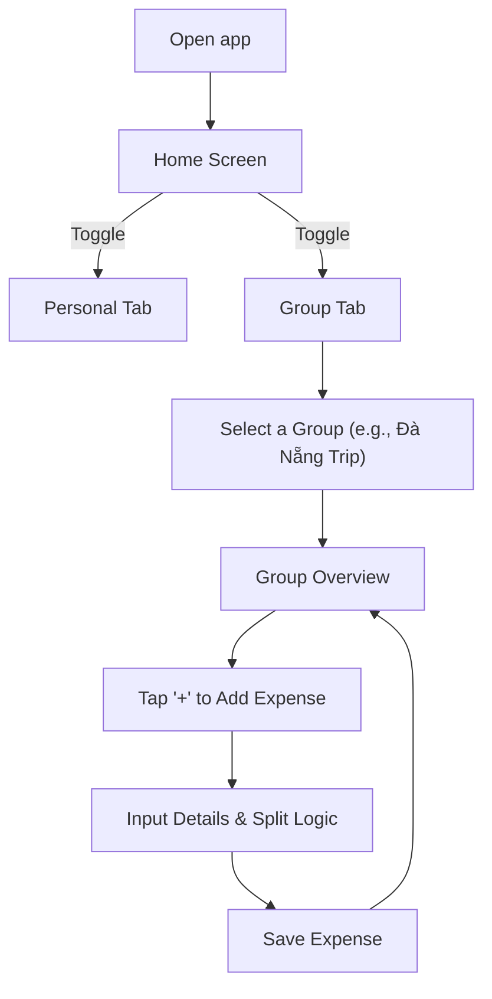

---

## 3. Screen Inventory

| ID | Screen | Purpose | Main components | Data source |
|:--:|--------|---------|-----------------|-------------|
| `SCR-01` | **Home (Personal)** | Dashboard for individual finance. | Balance card, Income/Expense summary, Saving goal progress, Recent transactions. | Local DB (SQLite/Room) |
| `SCR-02` | **Home (Group)** | List of active shared groups and tasks. | Group cards (members, budget), Task list summary. | API / Local Cache |
| `SCR-03` | **Group Overview / Detail** | Main hub for a specific group. | Tab bar (Overview, Expenses, Tasks, Members, Settlement), Budget progress bar, Quick stats. | API / Local Cache |
| `SCR-04` | **Add Expense** | Form to log a shared bill. | Amount input, Category picker, Payer selection, Split distribution (equal/custom). | User Input -> API |
| `SCR-05` | **Expense Detail** | View breakdown of a specific bill. | Total amount, Payer, List of members with calculated owed amounts. | API / Local Cache |
| `SCR-06` | **Member Detail** | Show financial standing of one person. | Total paid, Total owed, Received amounts, Related transactions. | API / Local Cache |
| `SCR-07` | **Wallet Management** | Quản lý danh mục ví thanh toán cá nhân. | Danh sách thẻ ví với bảng 10 màu Pastel ngẫu nhiên, tổng số dư các ví, nút tạo ví mới. | Local DB / Repository |
| `SCR-08` | **Transaction Form** | Form nhập thu nhập / chi tiêu cá nhân nhanh. | Trường nhập tiền, chọn danh mục, bộ chọn ví linh hoạt (kèm lựa chọn "+ Ví khác..." tạo ví tức thì). | Local DB / User Input |
| `SCR-09` | **Debt Settlement (Quyết toán)** | Tab quyết toán rút gọn nợ trong nhóm. | Thẻ thống kê (Đã chi, Phải chịu, Net Balance), danh sách chuyển tiền tối giản (Greedy matching), nút "Đồng bộ vào ví cá nhân". | `DebtSimplifier` / Group ViewModel |
| `SCR-10` | **Savings Goals** | Quản lý và theo dõi các mục tiêu tiết kiệm. | Danh sách mục tiêu, thanh tiến độ % hoàn thành, số tiền còn thiếu, nút nạp tiền vào quỹ. | Local DB (SQLite/Room) |
| `SCR-11` | **Auth (Login / Register)** | Xác thực và phân quyền tài khoản người dùng. | Form đăng nhập/đăng ký với kiểm tra tính hợp lệ dữ liệu trực quan (validation states). | Remote REST API / Keystore |

---

## 4. Wireframes

The UI design is based on the provided high-fidelity mockups.

### 4.1 Personal and Group Home

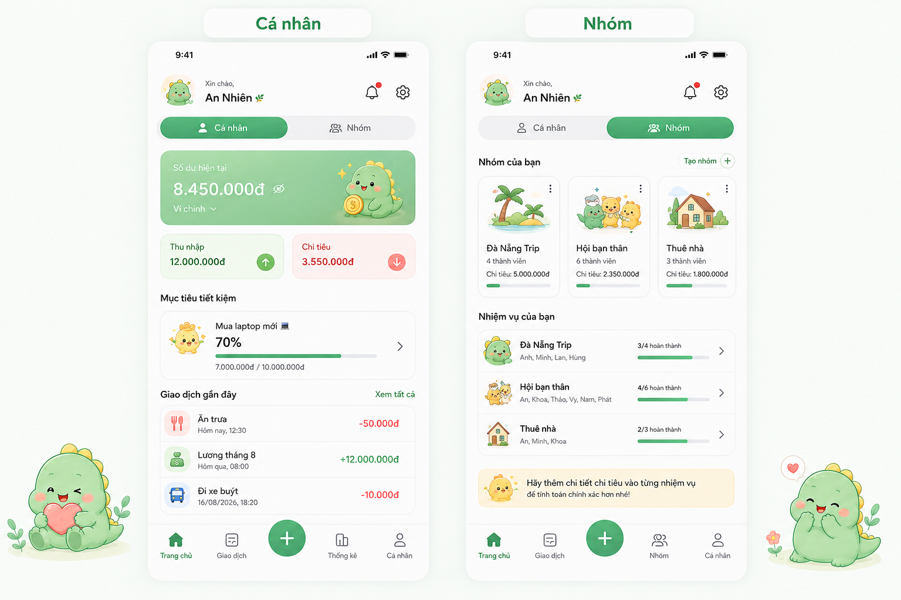

*Figure 1. Overview of the Personal and Group home dashboards.*

### 4.3 Actual Implemented Screens (Milestone M3 Screenshots)

Bằng chứng triển khai thực tế trên thiết bị di động (10 màn hình chuẩn):

| 01. Login | 02. Register | 03. Home (Personal) | 04. Transaction Form | 05. Savings Goals |
|:---:|:---:|:---:|:---:|:---:|
| 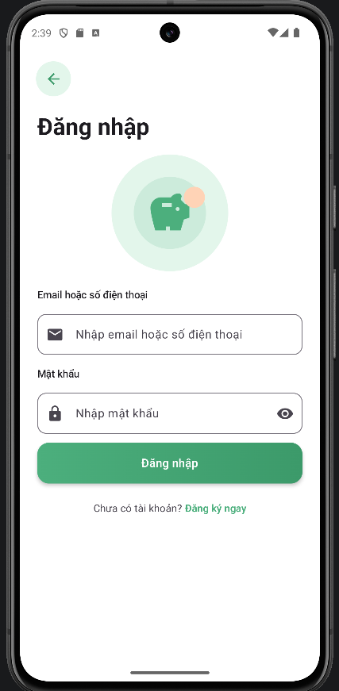 | 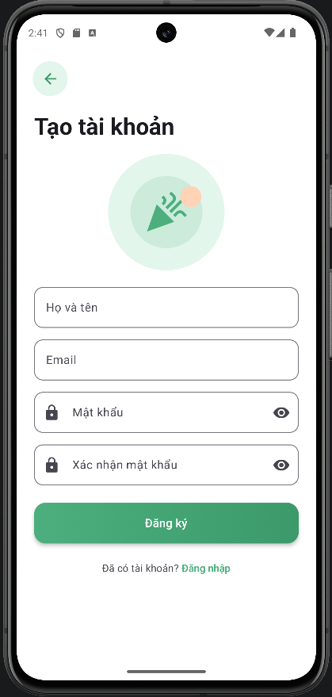 | 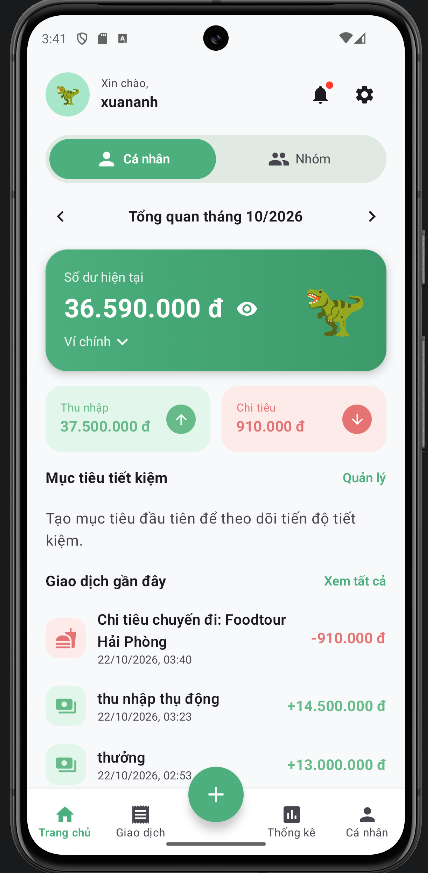 | 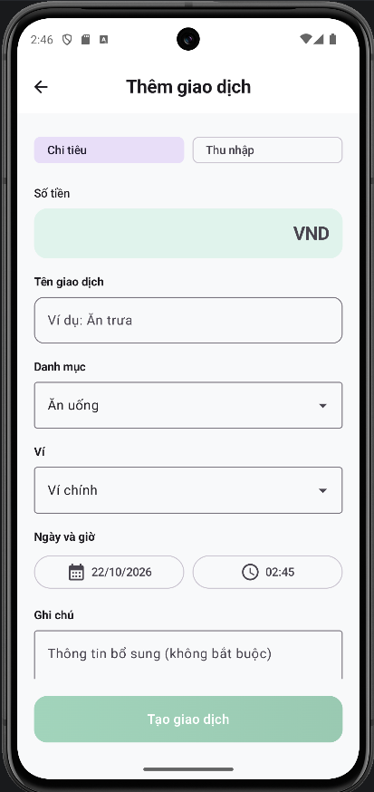 | 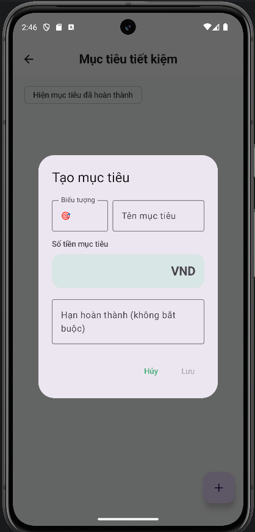 |

| 06. Wallet Management | 07. Home (Group) | 08. Group Detail | 09. Add Expense Split | 10. Debt Settlement |
|:---:|:---:|:---:|:---:|:---:|
| 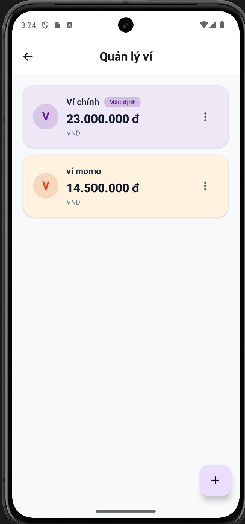 | 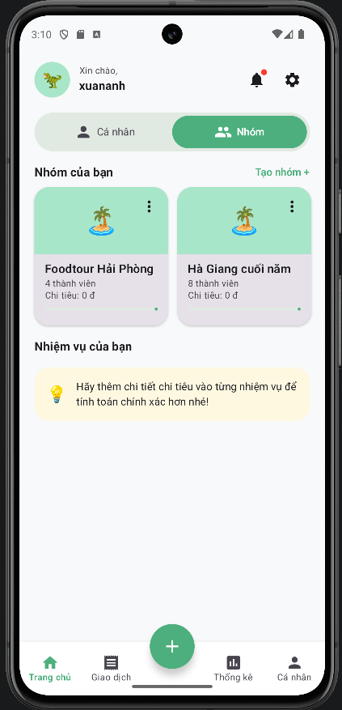 | 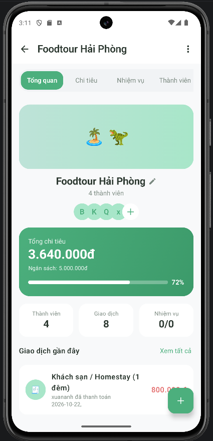 | 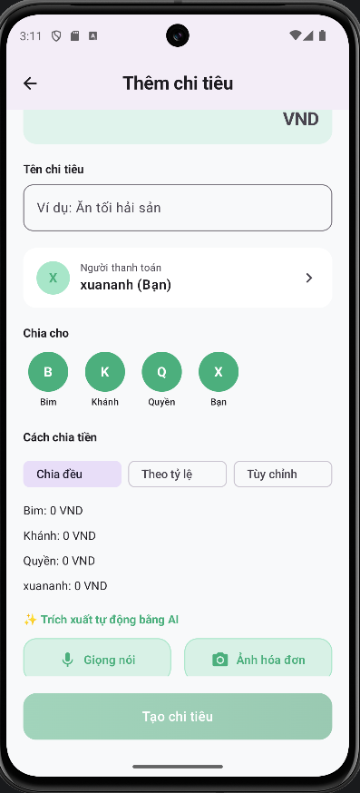 | 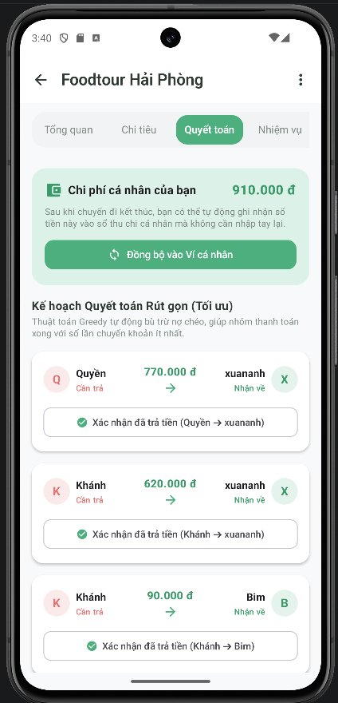 |

---

## 5. Design Tokens

### 5.1 Colors

| Token | Light | Dark | Usage |
|-------|-------|------|-------|
| `primary` | `#22C55E` (Green) | `#16A34A` | Main buttons, progress bars, positive numbers (Income), active tabs. |
| `secondary` | `#FEF3C7` (Soft Yellow) | `#D97706` | Warning states, saving goal accents, secondary icons. |
| `background` | `#F9FAFB` (Off-white) | `#1F2937` | App background, grouping containers. |
| `surface` | `#FFFFFF` | `#374151` | Cards, bottom navigation, input fields. |
| `text-primary` | `#111827` | `#F9FAFB` | Main headings, transaction names. |
| `error` | `#EF4444` (Red) | `#F87171` | Expenses, debt ("Cần trả"), delete actions. |
| `success` | `#10B981` | `#34D399` | Settled debts ("Đã thanh toán"), completed tasks. |
| `pastel-palette` | Bảng 10 màu Pastel nhẹ nhàng | Biến thể Pastel tối ưu | Hiển thị thẻ ví phân biệt trực quan trong `WalletManagementScreen` (`#E0F2FE`, `#DCFCE7`, `#FEF3C7`, `#FCE7F3`, `#F3E8FF`, `#CCFBF1`, `#FFEDD5`, `#EDE9FE`, `#CFFAFE`, `#F1F5F9`). |

### 5.2 Typography & spacing

| Token | Value | Usage |
|-------|-------|-------|
| `title` | 20sp Bold | App bar titles, large balance displays. |
| `body` | 14sp Regular | Transaction names, standard text. |
| `caption` | 12sp Medium | Dates, small tags, sub-labels. |
| `spacing-unit` | 8dp | Base unit for padding/margins (e.g., 16dp for screen edges). |

---

## 6. UI States

For the **Group Expenses List** screen:

| Screen | Loading | Success | Empty | Error (with retry) |
|--------|---------|---------|-------|--------------------|
| Group Expenses | Skeleton list items pulsing gently. | Shows list of transactions categorized by date. | Illustration of empty wallet + "No expenses yet. Tap + to add." | "Unable to sync group data." + Retry button. |

---

## 7. Accessibility & Adaptivity

- **Minimum touch target:** All buttons and list items are at least 48x48dp.
- **Contrast:** Red (expenses) and Green (income) are adjusted to pass WCAG AA contrast ratios against the white background.
- **Small screens:** The bottom navigation bar adapts by hiding text labels on very small devices.
- **Dark mode:** Uses a dark gray surface (`#374151`) rather than pure black to reduce eye strain, with pastel variations of the primary colors.

---

## 8. Design Decisions

| Decision | Alternatives considered | Why we chose this |
|----------|------------------------|-------------------|
| **Top-level Toggle (Personal/Group)** | Using the bottom navigation bar or a side menu (hamburger) for navigation between modes. | A top toggle clearly divides the app's two main contexts without burying the feature. It allows the bottom nav to remain context-sensitive (e.g., showing 'Statistics' only in Personal mode). |
| **Floating Action Button (FAB) at Bottom Center** | Putting an 'Add' button in the top right corner of every screen. | The central FAB is easily reachable with one hand and acts as a universal "quick add" contextually aware of the current tab (adds personal expense if in Personal, adds group expense if in Group). |